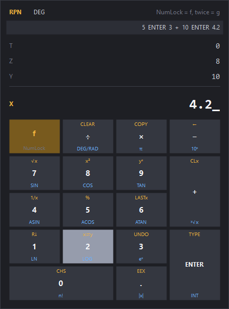

# RPN Numpad

Turn your keyboard's numeric keypad into an HP-style **RPN (Reverse Polish Notation) calculator** on Windows.
Press a key combination and the numpad becomes a calculator. Press it again and the numpad goes back to normal.

  



While RPN mode is on, a small calculator window stays on top of other windows. It shows:

* a **tape** of the keys you've pressed (e.g. `5 ENTER 3 + 10 ENTER 4.2`)
* the **stack** (T, Z, Y and X, with the number you're keying in shown in large type)
* an **on-screen keypad** laid out like the numpad. Each key you press lights up. Gold *f* functions are printed above each key and blue *g* functions below it, like on an HP-15C.

The window never takes focus, so you can keep working in the app underneath. Press f then Enter to type the result into that app.

## Build it yourself

No ready-made `.exe` is offered. You build it from the source code in about a minute.
That way you can see exactly what you're running: the whole app is one readable file, [`RpnNumpad.cs`](RpnNumpad.cs).

**You need:** Windows 10 or 11 and a keyboard with a numeric keypad. You don't need Visual Studio, the .NET SDK or anything else.
The build uses the C# compiler that's already part of Windows (`csc.exe` from .NET Framework 4.x).

### Step 1: Download the source

Choose one:

* **No git:** on this page, click the green **Code** button → **Download ZIP**.
  Right-click the downloaded ZIP → **Extract All…** and pick a folder you'll keep, such as `Documents\rpn-numpad`.
  > Tip: if Windows marks downloaded files as unsafe, right-click the ZIP → **Properties** → tick **Unblock** → **OK** *before* extracting.
* **With git:**
  ```
  git clone https://github.com/njoffe/rpn-numpad.git
  ```

### Step 2: Build

Open the folder and double-click **`build.cmd`**. A window flashes by and `RpnNumpad.exe` appears in the same folder.

To watch the build, or if nothing seems to happen, run it from a terminal instead:

```
cd path\to\rpn-numpad
build.cmd
```

When it works, the terminal shows:

```
Built "C:\...\rpn-numpad\RpnNumpad.exe"
```

<details>
<summary>What build.cmd does (the manual command)</summary>

```
%WINDIR%\Microsoft.NET\Framework64\v4.0.30319\csc.exe /nologo /target:winexe /optimize+ /codepage:65001 ^
  /out:RpnNumpad.exe /r:System.dll /r:System.Core.dll /r:System.Drawing.dll /r:System.Windows.Forms.dll RpnNumpad.cs
```

On 32-bit Windows the compiler is in `Framework` instead of `Framework64`.
</details>

### Step 3: Run

1. Double-click **`RpnNumpad.exe`**. A tray icon (an "R") appears near the clock, along with a short pop-up message.
   If you don't see the icon, click the **^** arrow in the taskbar to show hidden icons.
2. Press **Ctrl + Alt + Numpad Enter** to turn RPN mode on. The calculator window appears.
3. Press the same keys again to turn it off.

To have it start automatically, right-click the tray icon and choose **Start with Windows**.
If you move the folder later, turn that option off and on again so it points to the new location.

To quit, right-click the tray icon → **Exit**.

### Troubleshooting the build

| Problem | Fix |
|---|---|
| `The system cannot find the path specified` / compiler not found | .NET Framework 4.x is missing. It comes with every copy of Windows 10/11. On an unusual or stripped-down install, get the **.NET Framework 4.8 Runtime** from Microsoft's website. |
| `Build FAILED` with error lines | Make sure `RpnNumpad.cs` is in the same folder as `build.cmd` and wasn't edited. Download a fresh copy if needed. |
| `Access to the path ... is denied` | The app is still running. Exit it from the tray icon, then build again. Or the folder is read-only, so move it somewhere under `Documents`. |
| Antivirus deletes or quarantines the exe | The app uses a keyboard hook to capture numpad keys, which some antivirus programs flag on unknown programs. The source is all in `RpnNumpad.cs` for you to inspect. If you're comfortable with it, add the folder as an exclusion. |
| "Windows protected your PC" (SmartScreen) | Click **More info** → **Run anyway**. This happens with any unsigned program. |
| *"An Application Control policy has blocked this file"* | Smart App Control is on. See [If Windows blocks the exe](#if-windows-blocks-the-exe) below. |

### Updating

Download the new source (or `git pull`), exit the running app from the tray, and run `build.cmd` again.

### If Windows blocks the exe

If Windows reports *"An Application Control policy has blocked this file"*, **Smart App Control** is blocking
unsigned programs that you build yourself. Your options:

1. Sign `RpnNumpad.exe` with a code-signing certificate.
2. Turn off Smart App Control (Windows Security → App & browser control → Smart App Control).
   Windows won't let you turn it back on afterwards without resetting or reinstalling Windows.
3. Load the app from Windows PowerShell, which runs it inside the signed `powershell.exe`:
   ```powershell
   powershell.exe -NoProfile -STA -Command "[Reflection.Assembly]::Load([IO.File]::ReadAllBytes('C:\path\to\RpnNumpad.exe')).EntryPoint.Invoke(`$null, @())"
   ```
   Use `powershell.exe` (Windows PowerShell 5.1), not `pwsh`. Option 3 works around a security setting, so whether to use it is up to you.
   With this option the tray's *Start with Windows* setting is greyed out. To start the app automatically at sign-in,
   run this once in PowerShell (change the path to where your `RpnNumpad.exe` is). It adds a shortcut to your Startup folder:
   ```powershell
   $exe = 'C:\path\to\RpnNumpad.exe'
   $s = (New-Object -ComObject WScript.Shell).CreateShortcut("$([Environment]::GetFolderPath('Startup'))\RPN Numpad.lnk")
   $s.TargetPath = "$env:WINDIR\System32\WindowsPowerShell\v1.0\powershell.exe"
   $s.Arguments = "-NoProfile -STA -WindowStyle Hidden -Command `"[Reflection.Assembly]::Load([IO.File]::ReadAllBytes('$exe')).EntryPoint.Invoke(`$null, @())`""
   $s.WindowStyle = 7
   $s.Save()
   ```
   To stop it starting automatically, delete *RPN Numpad* from the Startup folder (press Win + R and type `shell:startup`).

## Enable / disable

**Ctrl + Alt + Numpad Enter** switches RPN mode on and off. You can also double-click the tray icon.
When RPN mode is off, the numpad works normally.

## How RPN works

Instead of `5 + 3 =`, you enter the numbers first and then the operation: `5 Enter 3 +`.
Numbers wait on a four-level **stack**:

```
T   ← top (oldest)
Z
Y
X   ← the number you're typing, or the latest result
```

* **Enter** copies X up into Y so you can type the next number.
* **An operation** (`+ − × ÷`) works on Y and X, puts the answer in X, and moves Z and T down one level.

Example: `(5 + 3) × (10 − 4)` → `5 Enter 3 + 10 Enter 4 − ×` → **48**. You never need parentheses.

## Keys (RPN mode on)

| Key | Function |
|---|---|
| `0`–`9` `.` | key in a number |
| `Enter` | ENTER (copies X into Y and pushes the stack up) |
| `+ - * /` | Y op X |
| `NumLock` | **f** (gold) shift for the next key |
| `NumLock` `NumLock` | **g** (blue) shift for the next key |

Pressing NumLock repeatedly cycles: normal → **f** → **g** → normal. A shift applies to one key only.
While a shift is active, the on-screen keys show only that shift's functions.

Gold **f** functions (press NumLock once, then the key):

```
 NumLock     /          *          -
 → g         CLEAR*     COPY X     ← backspace

 7           8          9          +
 √x          x²         yˣ         CLx

 4           5          6
 1/x         %          LAST X

 1           2          3          Enter
 R↓          x⇄y        UNDO       TYPE X (types X into the active app)

 0                      .
 CHS                    EEX
```

\* CLEAR empties the stack and wipes the tape, so the next calculation starts fresh.

Blue **g** functions (press NumLock twice, then the key). The header shows whether angles are in DEG or RAD.

```
 NumLock     /          *          -
 cancel      DEG/RAD    π          10ˣ

 7           8          9          +
 SIN         COS        TAN        ʸ√x  (x-th root of y)

 4           5          6
 ASIN        ACOS       ATAN

 1           2          3          Enter
 LN          LOG        eˣ         INT  (integer part)

 0                      .
 n!                     |x|
```

## Good to know

* Ctrl/Alt/Win + numpad keys pass through, so Alt codes and app shortcuts still work in RPN mode.
* Works with NumLock on or off. In RPN mode NumLock is captured, so its light doesn't change.
* Invalid operations (÷0, √ of a negative, tan 90°, …) show a red message and leave the stack unchanged.
* The stack, the angle mode and the window position are saved between sessions (in `HKCU\Software\RpnNumpad`).
  They're saved when you turn RPN mode off, exit, sleep, shut down or restart, so nothing is lost if Windows restarts for an update.
* Drag the window to move it. Right-click it or the tray icon for *Key map*, *Start with Windows* and *Exit*.

## How it works

`RpnNumpad.cs` is a single-file WinForms app. A low-level keyboard hook (`WH_KEYBOARD_LL`) intercepts numpad keys,
which are identified by scan code so they work regardless of NumLock state. The hook swallows those keys only while RPN mode is on.
The window uses `WS_EX_NOACTIVATE` so it never steals focus. The app has no network access and collects no data.

## License

[MIT](LICENSE). Free to use, change and share.
